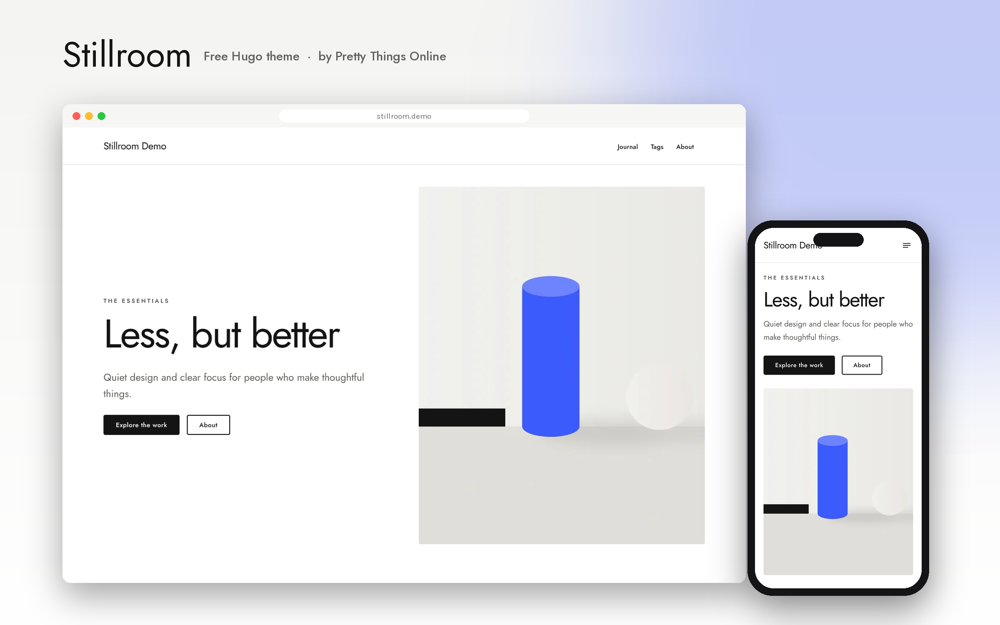

# Stillroom: a free Hugo theme by Pretty Things Online

A quiet, minimal theme with a split hero, a glassy header and lots of white space that lets your work speak.

Made with care by **[Pretty Things Online](https://prettythingsonline.com)**. Free for personal and commercial use under the MIT license.



## Features

- Home page hero (split layout) set from your config: eyebrow, heading, text, image and buttons
- Responsive post grid, single posts with related posts, tags, section and taxonomy pages, 404
- Three colour styles (Stillroom, Stone, Ocean) switched with one setting
- Bundled Jost fonts (no Google Fonts requests)
- Hugo image processing: responsive WebP feature images and Open Graph images
- Optional newsletter block that posts to any provider (Buttondown, Mailchimp, ConvertKit and others)
- Lightweight: one minified stylesheet, a few lines of JavaScript
- Accessible: skip link, visible focus styles, keyboard friendly, reduced motion support

**Style:** Clean minimal · **Great for:** studios, consultants, product brands, photographers and writers who like clean pages

## Quick start

Requires Hugo 0.146.0 or newer.

```bash
hugo new site my-site && cd my-site
git init
git submodule add https://github.com/jameseriksen74/hugo-theme-stillroom.git themes/stillroom
cp -r themes/stillroom/exampleSite/* .
hugo server
```

Or as a Hugo module: `hugo mod init my-site`, then in `hugo.toml` add

```toml
[module]
  [[module.imports]]
    path = "github.com/jameseriksen74/hugo-theme-stillroom"
```

## Configuration

See [`exampleSite/hugo.toml`](exampleSite/hugo.toml) for every option. The main ones:

| Setting | What it does |
| --- | --- |
| `params.palette` | Colour style: `Stillroom`, `Stone`, `Ocean` |
| `params.hero` | Eyebrow, heading, text, image (path in `assets/`) and buttons |
| `params.mainSections` | Which sections appear on the home page (default `posts`) |
| `params.newsletter` | Turn the sign-up block on and set your form `action` URL |
| `params.social` | Links in the footer |
| `params.hideCredit` | Hide the footer theme credit |
| `menus.main`, `menus.footer` | Header and footer links |

Feature images: put an image named `feature.jpg` (or `.png`, `.webp`) in a page bundle, or set `image = "images/x.jpg"` (a path in `assets/`) in front matter.

## Theme credit

The footer shows a small "Stillroom theme by Pretty Things Online" link. You can hide it with `hideCredit = true`, but keeping it is a lovely way to say thanks.

## License

MIT. Fonts are SIL Open Font License 1.1. Images are original artwork released under CC0.
